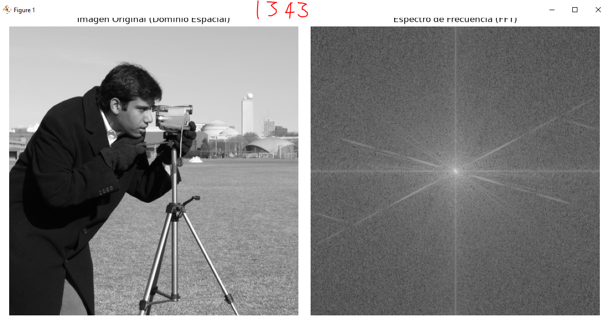
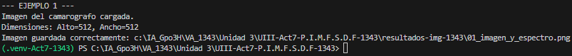
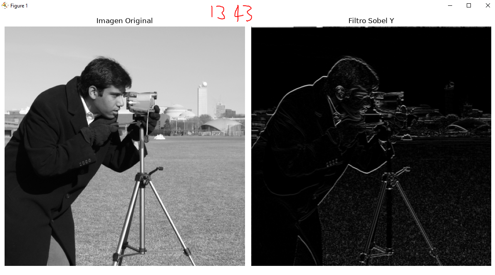
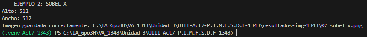
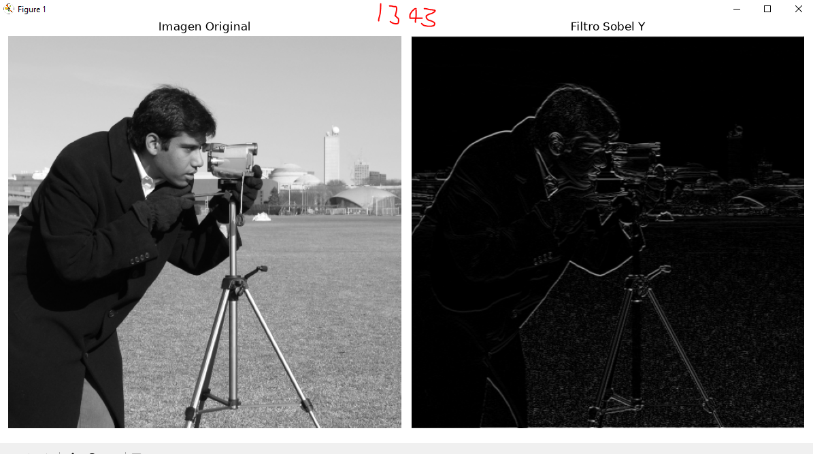
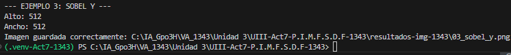
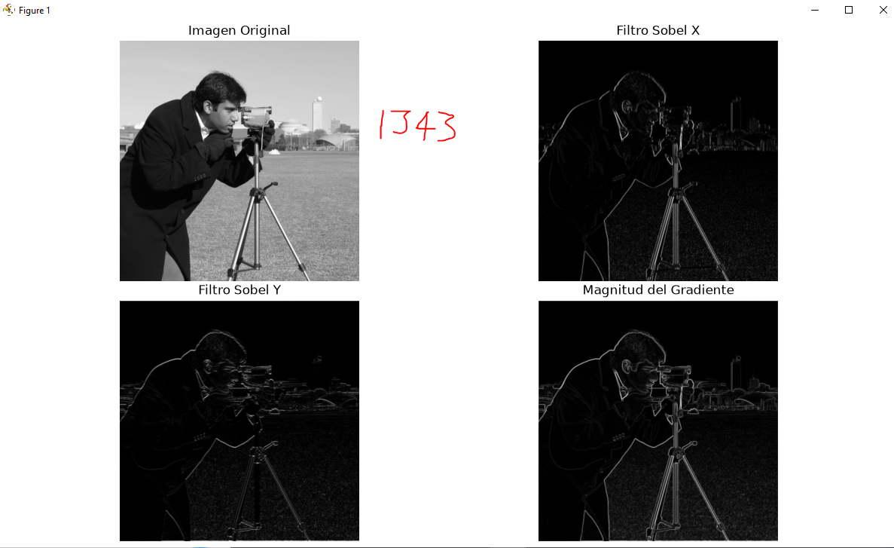
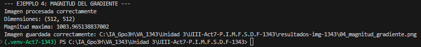

## Daniel Nieves NC = 1343
## Vision Artificial
## ejemplo1-Escpectro
# imagen ejemplo 1

# terminal ejemplo 1

## ejemplo2-sobel-X
# imagen ejemplo 2

# terminal ejemplo2

## ejemplo3-sobel-y
# imagen ejemplo 3

# Terminal ejemplo 3

## ejemplo4-magnitud-gradiente
# Imagen ejemplo 4

# Terminal ejemplo 4
